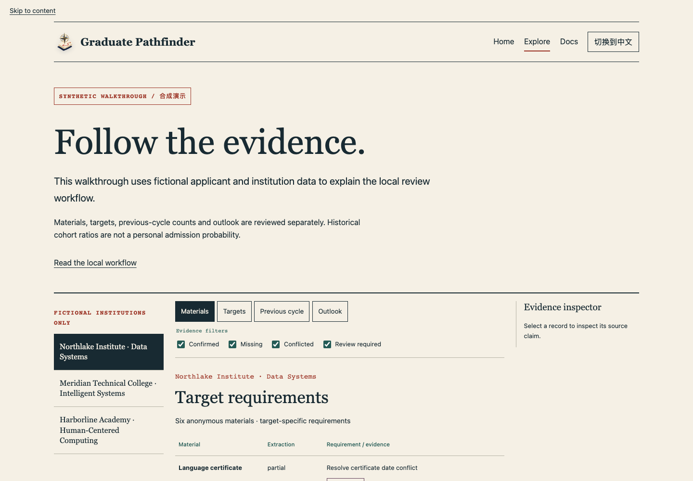
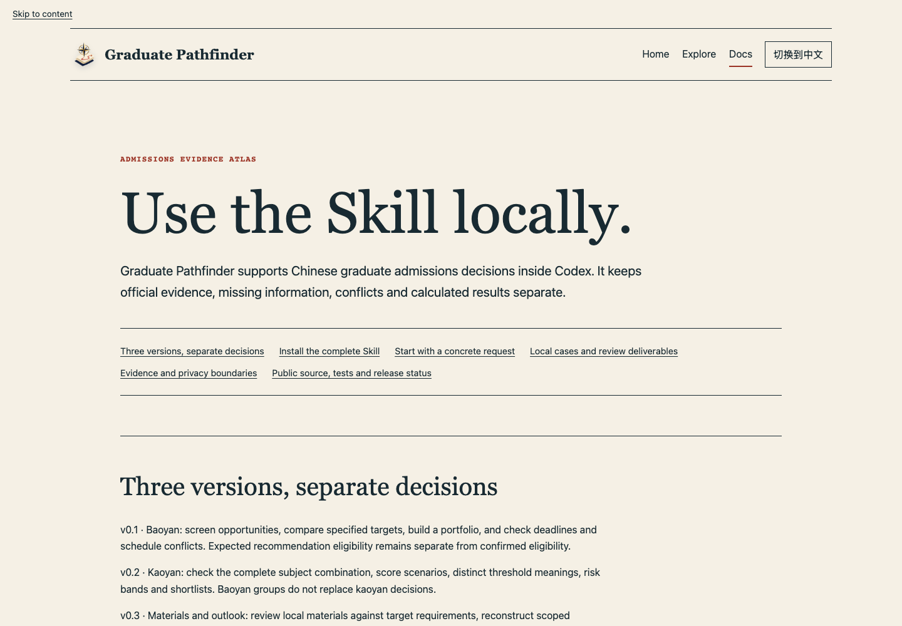

<p align="center">
  
</p>

<h1 align="center">研途择校 · Graduate Pathfinder</h1>

<p align="center"><strong>循证据，辨路径，让不确定性保持可见。</strong><br>一个面向中国研究生招生决策的本地优先 Codex Skill。</p>

<p align="center"><a href="README.en.md">English</a> · <a href="README.md">中文主首页</a> · <a href="https://z-lab-boop.github.io/graduate-pathfinder/">公开站点</a> · <a href="https://z-lab-boop.github.io/graduate-pathfinder/explore.html">合成案例</a> · <a href="https://z-lab-boop.github.io/graduate-pathfinder/docs.html">文档</a></p>

<p align="center"><code>本地优先</code> · <code>证据优先</code> · <code>English / 中文</code> · <code>v0.3</code></p>


[安装说明](https://z-lab-boop.github.io/graduate-pathfinder/docs.html#install) · [发布状态](https://z-lab-boop.github.io/graduate-pathfinder/docs.html#source)

公开站点仅演示虚构申请者与虚构院校，不接收上传、不追踪用户，不提供个人录取概率或录取保证。概念艺术与合成产品截图分别标注。目前未发布带二进制附件的标签版本，请安装完整源码仓库；网站资源与截图属于文档，不是二进制发布物。以上链接是预定 Pages 路由，本地核验不证明站点已上线。

## 视觉图谱

三张原创概念艺术分别表现产品旅程中的证据、材料和路线。它们不是申请者证据、真实材料或可识别院校图像。

| 证据图谱 | 材料复核 | 路线比较 |
| :---: | :---: | :---: |
|  |  |  |
| 每个结论都回溯到来源。 | 分开复核就绪度、缺口与冲突。 | 比较不同路径，不把历史数据写成承诺。 |

## 产品边界

本项目是本地优先的决策支持工具，不是招生官方系统，也不内置“全国完整院校数据库”。它要求按具体入学年份和目标身份核验实时官方证据；数据缺失、过期或冲突时，结论保持 `unknown`、`conflicted` 或 `evidence_insufficient`。

它不会：

- 代投、登录报名系统、发送消息、联系导师或接受录取；
- 认证材料真伪，修改原始文件，或把简历陈述自动升级为已验证事实；
- 承诺录取，或在没有合法、可比、已评估的个体级数据和可用模型时输出个人录取概率。

## 支持范围

| 版本 | 模式 | 主要能力 |
| --- | --- | --- |
| v0.1 | 保研 | 机会筛选、目标对比、投递组合、截止日期与日程冲突 |
| v0.2 | 考研 | 科目门、分数情景、分层线语义、风险带和 shortlist |
| v0.3 | 材料与展望 | 本地材料清单与复核、上年度时间/阶段人数重建、可比口径比率、序数竞争档位与证据信心 |

保研与考研的门槛、分组和报告契约始终分开。对混合请求，Skill 先确定当前路径和入学年份，再加载所需参考文档。

## 安装

1. 从本页 **Code** 菜单复制 HTTPS 地址，将仓库克隆到任意本地目录。
2. 将该目录链接到 Codex 的 skill 目录；若目标已存在，先检查，不要覆盖。

macOS/Linux 示例（在仓库根目录执行）：

```bash
set -eu
codex_root="${CODEX_HOME:-$HOME/.codex}"
skill_parent="$codex_root/skills"
skill_target="$skill_parent/graduate-pathfinder"
mkdir -p "$skill_parent"
if [ -e "$skill_target" ] || [ -L "$skill_target" ]; then
  printf '%s\n' "Refusing to overwrite existing skill target: $skill_target" >&2
  exit 1
else
  ln -s "$(pwd)" "$skill_target"
  python3 "$skill_parent/.system/skill-creator/scripts/quick_validate.py" "$skill_target"
fi
```

也可将仓库完整复制到 `$CODEX_HOME/skills/graduate-pathfinder`（默认 `$HOME/.codex/skills/graduate-pathfinder`）。不要只复制 `SKILL.md`；流程依赖 `references/`、`scripts/` 和 `agents/`。

## 使用示例

将以下原有中文提示粘贴到 Codex，并按实际案例调整事实。

```text
使用 $graduate-pathfinder，我是计算机专业前 5%，做一份 2027 保研投递组合。
```

```text
使用 $graduate-pathfinder，我估分 355，想考长三角的控制工程，先核对科目组合和官方口径，再给 shortlist。
```

```text
使用 $graduate-pathfinder，我会提供简历、成绩单和推荐信草稿。请复核这个保研目标的材料，整理上一可比年度的面试时间和各阶段人数，再给出序数竞争档位和不确定性。
```

在用到当前规则、截止日期、往年名单或人数时，应允许 Codex 浏览并优先核对官方来源。无浏览能力时，Skill 只依据用户提供的官方材料和本地案例工作，保留证据缺口，并停止依赖缺失事实的判断。

## 本地案例与隐私

- 普通初筛可仅在对话中返回结果。只在用户要求持久化或文件交付时建立案例。
- 案例必须位于已安装的 skill 目录之外；默认为当前工作目录下的 `graduate-pathfinder-cases/<anonymous-label>/`。
- 原始材料保持在用户选定的本地位置。清单记录路径、哈希和抽取状态，不会因建清单而复制或改写原文件。
- 个人证件号、学号、电话、私人邮箱、签名和家庭住址不应进入公开仓库、Issue 或可分享报告。自动脱敏后仍需人工复核。
- 公开仓库只含虚构测试数据，不包含真实申请者案例或从限制来源复制的数据集。

## 输出

深度择校可交付 `profile.json`、`candidates.json`、`evidence.json`、`candidate-matrix.csv`、`report.md` 和可选的 `deadlines.ics`。刷新模式另交付 `changes.md`。

v0.3 材料复核/展望要求公开安全的五件套：

- `material-audit.md`：分目标的完整性、条件缺口与冲突；
- `applicant-claims.json`：规范化学术事实及其证据状态；
- `historical-cycle.json`：明确口径的时间线、阶段人数、计算与拒算原因；
- `admission-outlook.md`：独立的资格、材料就绪度、竞争档位、适配和证据信心；
- `privacy-review.md`：脱敏检测范围、可能误脱敏和人工复核状态。

`materials-manifest.json`、材料需求、完整证据审计和原函数返回值仅作本地复核输入/中间件，不是默认公开交付物。公开安全输出在分享前仍需脱敏和人工隐私复核。

## 历史比率不是个人概率

`final_admitted / confirmed_attended` 等历史阶段比率只能在年份、院校、院系、专业代码、学位类型、方向和招生轮次完全一致且分母可核验时计算。它们是对对应历史范围的描述，不是当前申请者的录取概率。竞争档位是透明的序数判断，与保研投递分组、考研风险带分开，不保证录取。

## 合成产品视图

以下浏览器截图呈现虚构案例与本地安装指引。概念艺术仅作视觉比喻，不是申请者证据或真实院校图像。





## 验证

在仓库根目录运行：

```bash
python3 -m unittest discover -s tests -v
python3 /path/to/skill-creator/scripts/quick_validate.py .
python3 -m compileall -q scripts tests
npm --prefix web ci
npm --prefix web run typecheck
npm --prefix web run test:site
npm --prefix web run capture:site
node scripts/check-site-assets.mjs
git diff --check
```

若环境缺少 Playwright Chromium，请运行 `npm --prefix web exec playwright install chromium`。截图由专属动态 localhost 子进程服务，固定英语、1440×1000 视口、设备倍率 1 与减少动态效果。每张图片均记录页面顶部视口，不是整页；Explore 初始为 Northlake / Materials，启用全部证据筛选器。在同一平台连续运行两次并比较 SHA-256。见[截图规范与艺术资源审计](docs/assets/README.md)。

这些自动验证检查结构、决策逻辑和合成行为；它们不验证真实材料的真伪，也不证明实时招生数据已全国覆盖或当前完整。部署后仍需另行核验托管 CI 与线上 Pages。

## 研究基础与许可

开源项目调研、蒸馏的通用机制与复用状态见 [references/research-basis.md](references/research-basis.md)。本仓库不默认复制其代码或数据；引入任何第三方文件前须另做文件级许可和归属审计。

本项目以 [MIT License](LICENSE) 发布。
